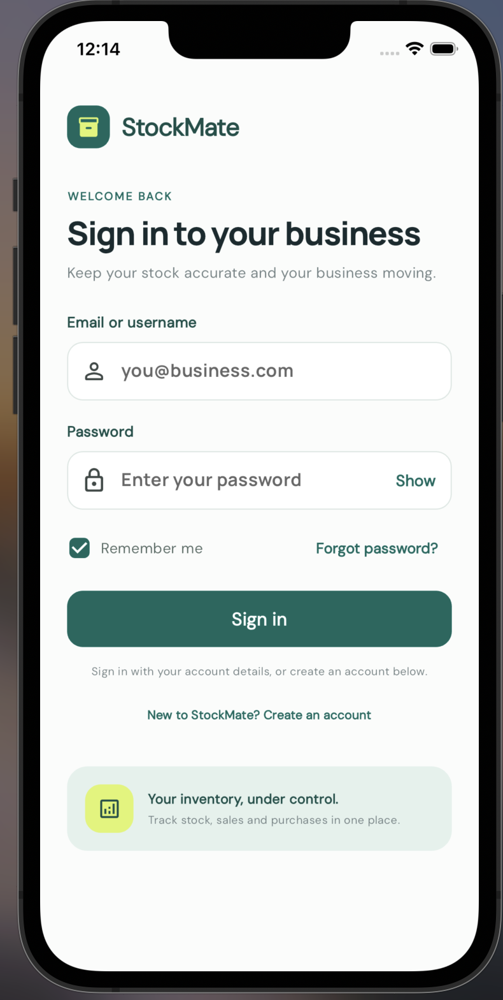
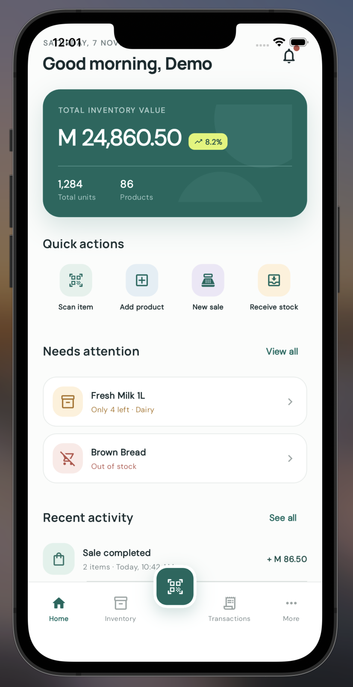
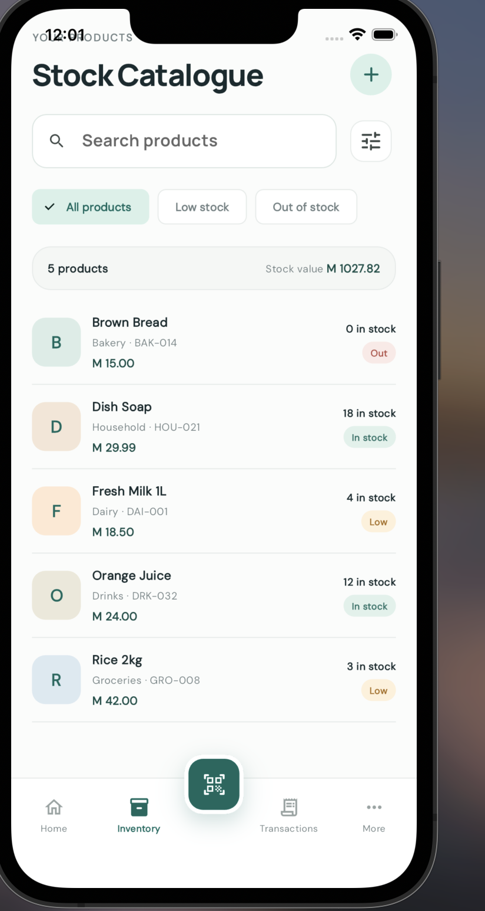
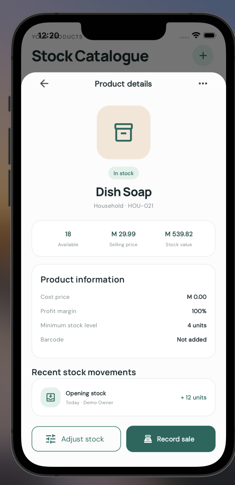
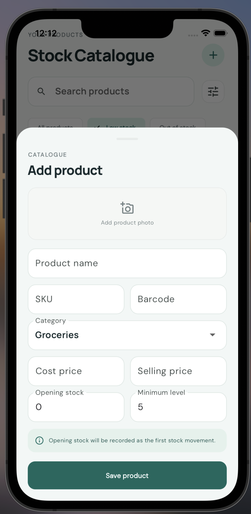
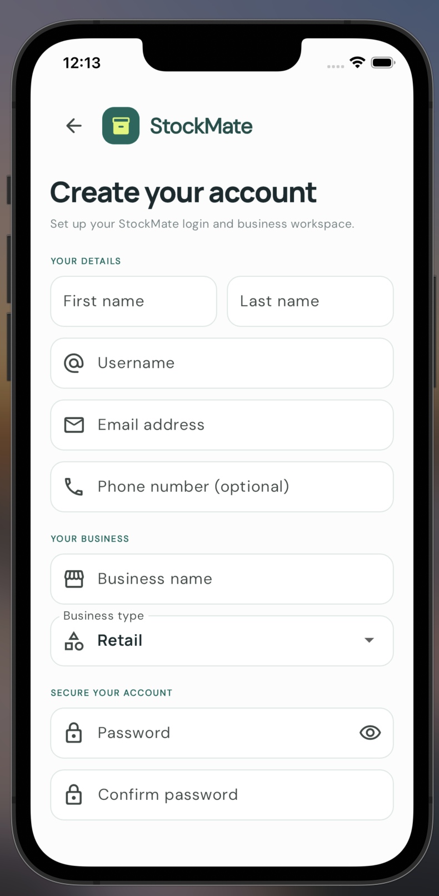

# StockMate

**Know what is in stock. Keep your business moving.**

StockMate is a Flutter inventory-management prototype for small retail and wholesale businesses. It brings product catalogue, stock levels, low-stock alerts, purchasing, and sales activity into one mobile-first experience.

> This repository is an actively developed portfolio project. The screens and local inventory workflows are implemented as a prototype; some flows still use sample data and are not connected to a production service.

## Preview

Add the emulator screenshots to `docs/screenshots/` using the filenames below. The images will appear here automatically once added.

| Sign in | Dashboard |
| --- | --- |
|  |  |

| Inventory catalogue | Product details |
| --- | --- |
|  |  |

| Add a product | Account registration |
| --- | --- |
|  |  |

## The problem StockMate addresses

Many small businesses track stock in notebooks, spreadsheets, or memory. That makes it easy to lose track of what is available, miss a reorder, or struggle to explain where stock went.

StockMate is designed to make everyday stock work easier:

- **One product catalogue:** keep product names, SKUs, categories, prices, and stock levels together.
- **Fewer stock surprises:** highlight low-stock and out-of-stock products so users can act sooner.
- **Clearer stock changes:** record adjustments as movements with before and after quantities.
- **A simpler daily view:** surface inventory value, quick actions, alerts, and recent activity from the dashboard.
- **A workspace for a business:** create an owner account and business profile during registration.

## What users can do

### Create an account

1. Launch the app and select **New to StockMate? Create an account**.
2. Enter your name, username, email, and password.
3. Add your business name and business type.
4. Select **Create account**. The first account is assigned the business owner role and is signed in.

Passwords must be at least eight characters. Local account passwords are stored as salted PBKDF2-HMAC-SHA-256 hashes, not plain text.

### Sign in

Sign in with the email address or username used during registration. The demo account is:

- **Username:** `demo`
- **Email:** `demo@stockmate.local`
- **Password:** any non-empty value (demo account only)

### Review the dashboard

The dashboard summarizes inventory value, stock units, product count, attention items, recent activity, and products running low. Quick actions lead to the main catalogue, scanner preview, and transaction area.

### Find and inspect products

Open **Inventory** to search the catalogue or filter by all products, low stock, and out of stock. Select a product to see its stock status, price information, and recent movement preview.

### Add a product

From the catalogue, select **+**. Enter the product name, SKU, category, prices, opening quantity, and minimum stock level. Saving creates the product and its opening stock movement in the local database on Android and iOS.

### Adjust stock

Open a product and select **Adjust stock**. Set the counted quantity and save. The on-device database updates the stock balance and writes the related stock adjustment and movement in a single transaction.

## Current implementation

| Area | Status |
| --- | --- |
| Sign-in and registration screens | Implemented |
| Local account registration with email and username login | Implemented |
| Business, owner role, and main location creation | Implemented locally |
| Product catalogue, search, and stock filters | Implemented with demo products |
| Add product and opening stock movement | Stored in SQLite on Android/iOS; in memory in Chrome |
| Stock adjustment and movement history | Stored transactionally in SQLite on Android/iOS; in memory in Chrome |
| Dashboard | Implemented with sample summary and activity data |
| Product details | Implemented; some activity content is sample data |
| Forgot password | Screen implemented; email delivery is not connected |
| Scanner | Scanner preview implemented; camera/barcode scanning is not connected |
| Sales and purchases | Transactions screen uses sample entries; recording transactions is not connected |
| Cross-device accounts and data sync | Not implemented; there is no backend API yet |

The SQLite database creates the core StockMate schema, including businesses, users, roles, products, stock balances, stock movements, sales, purchases, notifications, and audit tables. The current client workflows primarily use the account, business, product, stock balance, adjustment, and movement records.

## Technology and engineering

- **Flutter and Dart** for a responsive Android, iOS, and web interface.
- **Feature-based project structure** to keep authentication, dashboard, and inventory code in focused areas.
- **SQLite with `sqflite`** for on-device relational storage on Android and iOS.
- **Transactional stock updates** so balance and movement records are saved together.
- **Salted password hashing** for locally registered prototype accounts.
- **Reusable theme and UI components** for consistent colors, typography, spacing, cards, and controls.
- **Responsive layouts** for compact phones, standard phones, tablets, and web previews.

## Run the app

Install Flutter, then from the repository root:

```bash
flutter pub get
flutter run
```

To launch on a specific device, first check the Flutter device list:

```bash
flutter devices
flutter run -d <device-id>
```

Check the Dart code with:

```bash
flutter analyze lib
```

SQLite persistence is enabled on Android and iOS. The Chrome preview uses browser preferences for locally registered accounts and in-memory sample inventory because the app's current `sqflite` integration is native-platform only.

## Project structure

```text
lib/
├── app.dart
├── main.dart
├── core/
│   ├── database/
│   └── widgets/
├── features/
│   ├── app_shell/
│   ├── auth/
│   ├── dashboard/
│   └── inventory/
└── theme/
```

## Screenshot checklist

Capture the app in the Android emulator at a phone-sized viewport. Save PNGs under `docs/screenshots/` with these names:

1. `sign-in.png` — sign-in screen with the full heading and inventory message.
2. `registration.png` — account and business registration form.
3. `dashboard.png` — inventory summary, quick actions, alerts, and activity.
4. `inventory.png` — catalogue with status chips and product rows.
5. `product-details.png` — product sheet with stock details and actions.
6. `add-product.png` — add-product form.

Use the same emulator size and theme for each capture. Keep the status bar visible where possible, and avoid screenshots with keyboard overlap, validation errors, or transient loading indicators. Add or replace the image files and commit them with the README to publish the screenshots on GitHub.

## Product direction

StockMate is being built toward an offline-friendly stock workflow that helps small businesses maintain accurate product counts and understand changes over time. Planned next steps include connecting sales and receiving flows to the stock ledger, implementing barcode scanning and password recovery, and adding a backend for secure multi-device business access and synchronization.

## License

No license has been added yet.
